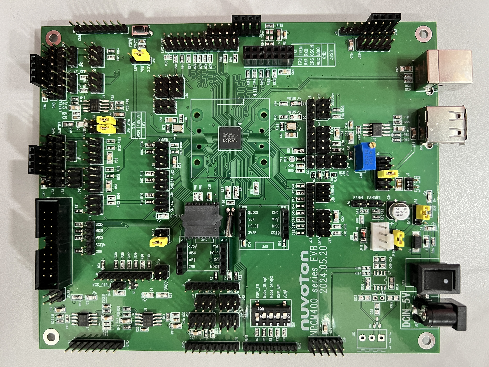

.. _npcm500_evb:

Nuvoton NPCM500_EVB
####################

Overview
********

The NPCM500_EVB kit is a development platform to evaluate the
Nuvoton NPCM5 series microcontrollers. This board needs to be mated with
part number NPCM500.

Hardware
********

- ARM Cortex-M4F Processor
- 768 KB RAM and 64 KB boot ROM
- ADC & GPIO headers
- UART0 and UART1

Supported Features
==================

The following features are supported:

+-----------+------------+-------------------------------------+
| Interface | Controller | Driver/Component                    |
+===========+============+=====================================+
| NVIC      | on-chip    | nested vector interrupt controller  |
+-----------+------------+-------------------------------------+
| ADC       | on-chip    | adc controller                      |
+-----------+------------+-------------------------------------+
| CLOCK     | on-chip    | reset and clock control             |
+-----------+------------+-------------------------------------+
| GPIO      | on-chip    | gpio                                |
+-----------+------------+-------------------------------------+
| I2C       | on-chip    | i2c port/controller                 |
+-----------+------------+-------------------------------------+
| I3C       | on-chip    | i3c port/controller                 |
+-----------+------------+-------------------------------------+
| PINMUX    | on-chip    | pinmux                              |
+-----------+------------+-------------------------------------+
| UART      | on-chip    | serial port-polling;                |
|           |            | serial port-interrupt               |
+-----------+------------+-------------------------------------+
| WDT       | on-chip    | watchdog                            |
+-----------+------------+-------------------------------------+

The default configuration can be found in the defconfig file:
:zephyr_file:`boards/nuvoton/npcm500_evb/npcm500_evb_defconfig`

Connections and IOs
===================

Nuvoton to provide the schematic for this board.

System Clock
============

The NPCX400 MCU is configured to use the 96Mhz.

Serial Port
===========

UART0 is configured for serial logs.

Programming and Debugging
*************************

This board comes with a Cortex ETM port which facilitates tracing and debugging
using a single physical connection. In addition, it comes with sockets for
JTAG-only sessions.

Flashing
========

``west flash`` writes ``build/zephyr/<KERNEL_BIN_NAME>_flash.bin`` to the MCP SPI flash
(W25Q16PW on FIU2) with the ``npcm500_mcp`` runner. The MCU is halted, with its watchdogs off and
its SRAM overwritten by the programmer and the image buffer, so it cannot be resumed or debugged
afterwards, so once programming succeeds the runner resets the Caliptra subsystem, MCU included,
and its ROM boots the new image. With ``--no-reset`` the MCU stays halted: power-cycle the board
to boot it. Board support files are in ``support/``.
Programming always runs on the Caliptra MCU (RISC-V), with JTAG connected to the MCU.

.. list-table::
   :header-rows: 1

   * - Command
     - Path
   * - ``west flash``
     - Uses OpenOCD to load ``mcp_stub.bin`` and the image into Caliptra MCU SRAM over the
       debug system bus. Works with any OpenOCD-supported JTAG adapter
       (``--config <adapter>.cfg``).

Other options: ``--no-reset`` (leave the MCU halted), ``--offset`` (4 KB aligned), ``--speed``
(JTAG kHz), ``--config`` (OpenOCD adapter config, default ``interface/jlink.cfg``), ``-f``
(another image). The on-target
programmer ``mcp_stub.bin`` is prebuilt; ``make -C support/src`` rebuilds it.

Build and flash the shell module sample.::

  west build -p auto -b npcm500_evb samples/subsys/shell/shell_module/
  west flash

Debugging
=========

Use JTAG/SWD with a J-Link

References
**********
